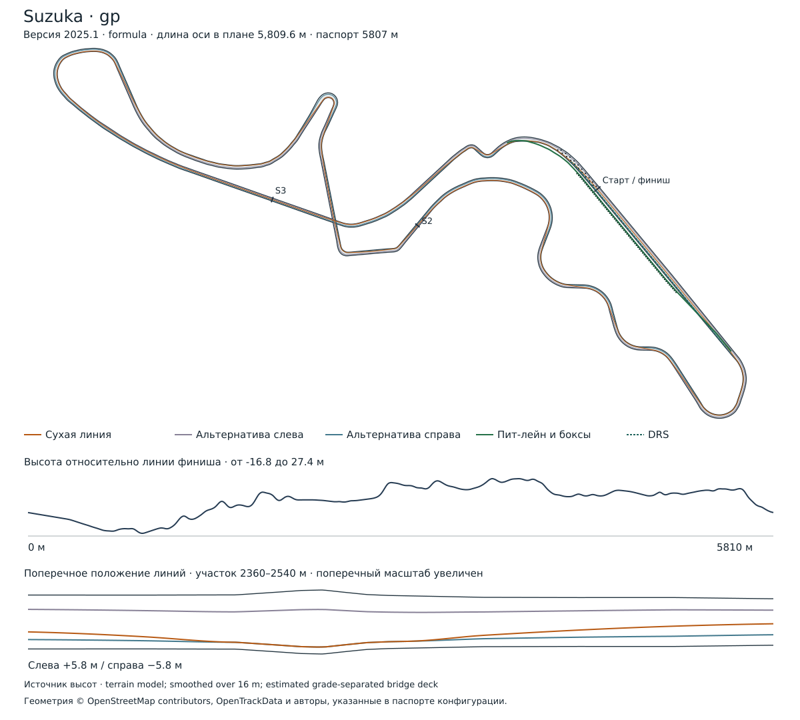

# Реальные трассы и пространственное ядро

Версия данных `2025.1` покрывает 109 событий на трассе и 53 конфигурации календаря. Этапы, тесты и приглашённые гонки ссылаются на одну и ту же карту при совпадении конфигурации. У Donington Park и Silverstone отдельные круги GP и National. Презентации машин исключены. Каждый файл содержит неизменяемую пару идентификатора и версии, паспортную длину, источники, оценки качества и две последовательности поперечных сечений. Следующую ревизию карт следует публиковать под новой версией. [Каталог](../../backend/race/data/2025.1)

## Технический чертёж

Чертёж строится из результатов нативного модуля. На плане видны края полотна, решётка, три линии, разметка секторов, DRS и боксы. Нижние панели показывают профиль высоты и увеличенный фрагмент в координатах трассы. Параметр `--detail-at` задаёт центр этого фрагмента в метрах от старта.



```sh
uv sync --locked --python 3.12
uv run --locked python scripts/build_race.py --test
uv run --locked python scripts/inspect_track.py suzuka:gp suzuka.svg --detail-at 2450
uv run --locked python scripts/inspect_track.py rdby-karting-ring:international rodby.svg --class kart --series kart-ok
uv run --locked python -m pytest -q backend/test_race_space.py
```

## Координаты и контракт v1

C++ хранит основную замкнутую ленту и открытую пит-ветку. Ось проходит через исходные сечения. Между ними построены кубические кривые Эрмита с общей касательной. Кривые разбиты на хорды с целевым интервалом 2 м. Дуга `s` интегрируется в горизонтальной плоскости. Она задаёт систему отсчёта и может отличаться от опубликованной длины круга. Оси локальной картографической системы направлены на восток и север при наличии `origin_lon_lat`. В прочих картах ориентация локальная.

| Величина | Единица и смысл |
|---|---|
| `road, s, lap` | Идентификатор ветки, дистанция в метрах по ней, число пересечений финиша. Основная лента периодична, обе границы пит-ветки включены |
| `d` | Метры влево от оси по ходу движения. Для горизонтальной единичной касательной `T=(tx,ty)` левая нормаль равна `N=(-ty,tx)` |
| `x,y,z` | `XY=Cxy(s)+d·N`, `Z=Cz(s)+d·crossfall`, метры. Вертикальный ноль указан в качестве источника высот |
| `curvature` | Знаковая кривизна в 1/м, `(x′y″−y′x″)/(x′²+y′²)^(3/2)`. Поворот налево имеет положительный знак |
| `grade, crossfall` | `dz/ds` и `dz/dd`, м/м. Угол уклона равен арктангенсу производной |
| `left, right` | Положительные полуширины в метрах. За границей асфальта последовательно расположены поребрик, зона вылета и внешняя область |
| `roughness` | Локальная оценка среднеквадратичной высоты неровностей, м |
| `Body` | Устойчивый ID, курсор, смещение, фактические длина, ширина и высота в метрах и отклонение курса в радианах |
| Сектора и DRS | Доли длины оси по ходу движения, начало включено, конец исключён. Интервал с концом меньше начала проходит через финиш |
| Решётка и боксы | Координаты `(s,d)` на основной или сервисной ленте. Номер позиции определяется порядком. Число показанных стартовых мест задаётся отдельно от состава участников |

Входной массив сечения содержит `[x,y,z,left,right,crossfall,roughness,kerb_left,kerb_right,runoff_left,runoff_right]`. Порядок колонок выходного снимка передаётся в `sample_columns`. Код поверхности равен 0 для асфальта, 1 для поребрика, 2 для зоны вылета, 3 за её пределами. Код обозначает геометрическую область. Модель сцепления будет использовать материал и состояние покрытия.

Пакетные операции pybind11 принимают сразу набор координат, курсоров или габаритов. Обработка идёт в C++ с освобождённым GIL. Статический BVH ускоряет поиск ближайшей хорды в трёх измерениях. `project` возвращает `s`, подписанное поперечное смещение и полную пространственную дистанцию до оси. Для габаритов используются сортировка по границе на оси X, вертикальные интервалы и тест разделяющих осей для повёрнутых прямоугольников. Касание считается пересечением. Результат упорядочен по ID и не зависит от порядка подачи машин.

`advance` переносит остаток пройденного расстояния через стык ветвей, сохраняя номер круга. Одна команда выбирает один возможный въезд. Финиш внутри пит-лейна засчитывается в его собственном створе. Положение и касательная совпадают с основной лентой на обоих концах, в том числе при поперечном смещении. Версионированный курсор восстанавливает ветку, дистанцию и круг. Пространственные запросы являются чистыми функциями и не расходуют RNG. Владелец сессии передаёт пройденное расстояние на границе своего фиксированного шага и сохраняет версию геометрии вместе с курсорами.

Сухая линия рассчитывается один раз для конфигурации и габарита класса. Периодическая релаксация сглаживает повороты вдоль заданной дистанции обзора, затем проецирует смещение в доступную полосу с резервом в полширины машины и боковым зазором. Параметр предпочтения от −1 до +1 непрерывно меняет линию. Для смены предпочтения на заданной дистанции применяется полином `6t⁵−15t⁴+10t³`. На пит-ветке линия стыкуется с выбранной основной траекторией и сужается вместе с коридором. Расчёт даёт начальное планирование для пилота. Допустимость манёвра целого повёрнутого автомобиля зависит от его габаритов и положения соседей.

Внешний потребитель получает тот же снимок через `GET /api/race/events/{event_id}/geometry?samples=512`. Допустимы 32–8192 сечения основной оси, число отсчётов сервисной ленты пропорционально её длине. Параметр `vehicle_class` меняет линии. Идентификатор события определяет опубликованную конфигурацию и применимость DRS.

## Достоверность данных

Геометрия осей получена из картографических источников, включая OSM, данные TUM и оцифрованный план Knockhill. Для F1 направление и положение старта совмещены с плановой телеметрией квалификации 2025 года. Паcпортная длина хранится отдельно от вычисленной. У Norisring и Knockhill масштаб локального плана привязан к опубликованной длине, поэтому совпадение длин у них зависимо от этой привязки. В Портимане выбран замкнутый путь GP через створ старта с исключением соединительных дорог. [Источники и лицензии](SOURCES.md)

- В 40 конфигурациях высоты получены из модели рельефа, в 13 используется оценочный относительный профиль. Высота полотна над нижней веткой Сузуки задана отдельно от растровой высоты земли.
- В 22 конфигурациях для ширины использованы картографические измерения целиком или на отдельных участках. На остальных 31 задана оценочная ширина. Для 12 привязанных съёмок TUM поле `width_survey_station_ranges` перечисляет включительные интервалы индексов исходных сечений. Две полуширины здесь восстановлены симметрично относительно оси OSM.
- Для 38 пит-лейнов найден картографический след. Для 15 коридор оценён относительно финишной прямой. Форма слияния, положение сервисных боксов и места на решётке оценочные.
- В 24 конфигурациях створы секторов привязаны к телеметрии F1 и ещё в трёх доступны картографические отметки. В Наварре три промежуточных створа на 1 255, 2 200 и 3 325 м образуют четыре сектора. Для остальных 25 сохранено оценочное деление на три сектора. Интервалы DRS приблизительны. Поперечные уклоны, поребрики, зоны вылета и неровности в основном оценочные. Для профиля виражей T3/T14 Зандворта учтены опубликованные значения банковки.
- Для Наварры подтверждены сезонная длина 4 313 м, перепрофилирование T6 и последовательность новой связки после T10. Неизменённые участки взяты из OSM. Положение новых апексов реконструировано по описанию реконструкции и касательной существующего участка. В доступном наборе геодезическая съёмка новых апексов отсутствует. [Описание работ оператора](https://www.circuitodenavarra.com/about/redevelopment) · [Проект Driven International](https://driven-international.com/circuito-de-navarra-redevelopment)

## Проверка и производительность

CTest проверяет аналитическую окружность, уклон, кривизну, смещения, классификацию поверхности и транспорт курсора. Успех определяется проверками, действующими и в Release. Геометрические тесты независимы от Python и запускаются также с ASan/UBSan. Python-тесты на Windows и Linux разрешают все события календаря, проверяют паспортную длину с допуском 1,2%, порядок секторов, линии, проходимость стыков, проекцию двух уровней Сузуки, параллельное движение, порядок контактов и восстановление курсора. При проверке пересечений ось разбивается на отрезки с интервалом 4 м. Межплатформенный контроль фиксирует длину и опорную мировую точку Сузуки с допуском 1 мм. Стык проверяется внутри каждой сборки с допуском 10⁻⁹ м. Оба компилятора используют строгую арифметику без fast-math.

Профиль локальной сборки Release получен на Linux x86-64 с GCC 14.2 и CPython 3.12. На Сарт пакет из 1 000 равномерных сечений занимал около 0,38 мс, обратная проекция 1 000 точек с поперечным смещением 1,5 м — около 0,42 мс. Замер включает преобразование Python-списков. Приведена медиана пяти серий по 80 пакетов после построения индекса. Это измерения пространственных запросов.

На Windows корневой `start.bat` сам вызывает сборку и проверяет импорт. CMake, pybind11 и Python-зависимости устанавливаются из lock-файла. Выбран MSVC v143. CMake отслеживает исходники и заголовки, путь к интерпретатору, ABI и параметры сборки входят в ключ каталога. Windows CI проверяет чистый запуск, использование актуального бинарника, пересборку после изменения C++, принудительное и штатное завершение в папке с пробелами и кириллицей. [Инструкции запуска](../../README.md)
