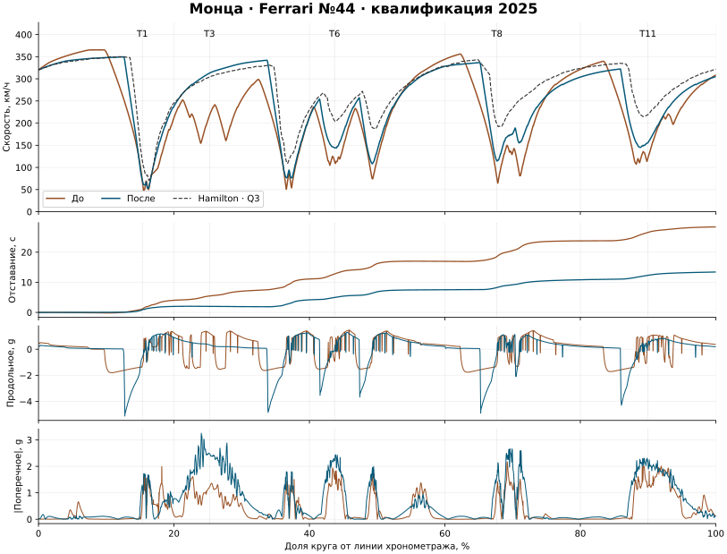
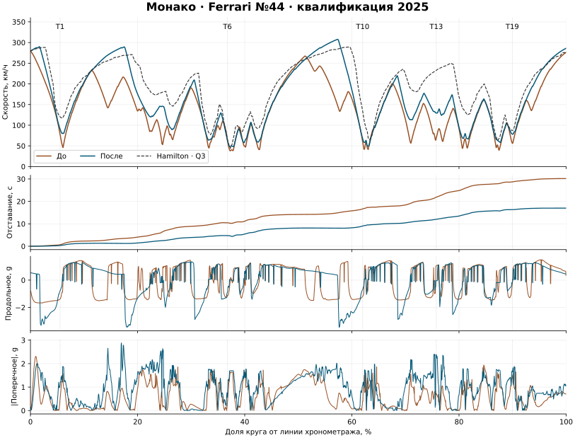

# Проверка динамики по телеметрии 2025 года

При воспроизведении заезда Ferrari №44 с 35 кг топлива, шинами C3 при 95 °C и нейтральной настройкой получены **110,755 → 96,535 с** в Монце и **104,463 → 90,896 с** в Монако. Это второй полный круг после старта с решётки. В Монце его сектора изменились с 34,386 / 37,769 / 38,600 до 28,714 / 34,441 / 33,379 с. В Монако — с 28,235 / 47,526 / 28,703 до 22,996 / 43,224 / 24,676 с. Перед быстрым кругом в баках оставалось соответственно 33,41 → 33,07 и 34,24 → 34,14 кг. База сравнения — коммит `52cbfaa`.

## Откуда взялась потеря времени

1. Старая линия укорачивала путь, прижимаясь к внутренней стороне дуги. Три варианта отличались масштабом того же поперечного смещения. Локальные изломы давали пики кривизны и лишние зоны торможения. На 1280–1720 м в Монце старая запись показывает педаль тормоза до 78% и минимум 155 км/ч. Теперь в этом интервале машина проходит дугу без тормоза, минимум 280 км/ч. Только замена построения линии на сглаживание мировых координат, при старых компонентах и контроллере, дала на промежуточном эксперименте 107,536 → 96,846 с и 100,573 → 95,195 с.
2. Пропорциональный регулятор требовал ошибки скорости для создания тяги и торможения. Одна точка впереди срезала смену направления в шиканах. Теперь базовый контроллер использует касательную, фактическую ошибку поперечного положения, кривизну линии и ускорение профиля. При отклонении возвращается на линию по дуге к достижимой точке. В профиле остаток продольной силы учитывает поперечную нагрузку. Общую команду тормозного давления ограничивает разгруженное колесо. Расчёт сил каждого колеса и интегрирование координат выполняются в обычном шаге ядра.
3. У F1 прежняя оценка суммарного момента 4320 Н·м при радиусе 0,33 м давала предел 13,1 кН даже на большой скорости. У первого поворота Монцы переход 337 → 89 км/ч занимал 261,5 м. После изменений — 134,4 м. Для круга Hamilton интерполяция публичной записи даёт 119,8 м. Brembo для этого поворота и сезона публикует 129 м, 2,75 с и пиковые 4,7 g. У Sainte Dévote в Монако переход 250 → 130 км/ч изменился со 112,4 до 72,8 м, в публичной записи — 55,5 м. Дистанции взяты по фактически пройденному пути между нисходящими пересечениями порогов. [Brembo, Monza 2025](https://brem-p-001.sitecorecontenthub.cloud/api/public/content/a7758d9026e14e81b940a82dd992941c?v=cc87e1fe)
4. В исходной аэрокарте формульных машин отсутствовала нагрузка переднего крыла. Её добавили в сборку шасси вместе с индуцированным сопротивлением и вкладом в нагрузку передней оси. В Монце максимум F1 снизился с 365,4 до 349,4 км/ч. В Монако достижимые скорости выхода выросли, максимум 307,8 км/ч выше реальных 289 км/ч. Командные карты крыльев и точная конфигурация Ferrari для двух уикендов закрыты. [Представление аэрокомпонентов Ferrari в FIA, сезон 2025](https://www.fia.com/system/files/decision-document/2025_spanish_grand_prix_-_car_presentation_submissions.pdf)
5. У младших формул общий пересчёт номинала в пиковый момент (`1,15 × кВт`) делал часть указанной мощности физически недоступной при рабочих оборотах. Например, у FR прежние 230 Н·м даже при 6800 об/мин дают всего 164 кВт до учёта формы кривой, при номинале 200 кВт. В новом каталоге согласованы двигатель и входной предел коробки. На испытании полной тяги F2, F3, F4 и FR достигают 99–100% номинала через установленную коробку. Для F2 использованы опубликованные 570 Н·м, для F4 — 270 Н·м. Для F3 и FR пики 365 и 335 Н·м оценены по мощности при 8000 и 6000 об/мин. [F2](https://www.fiaformula2.com/en/information/the-car-and-engine-f2.14LCsEEMG9yyx5DkhcN1J8) · [F3](https://www.fiaformula3.com/en/latest/article/the-car-and-engine-f3.5tGE8Qr5FdTJJwaUN0YbWq) · [Итальянская F4](https://www.ln4fusion.com/italian-f4) · [FRECA 2025](https://formularegionaleubyalpine.com/the-rules-and-regulations/)

**Контроль причинности.** На новой траектории с новым контроллером и одновременно обоими прежними узлами F1 получает 93,618 с и 89,495 с. При возврате только прежних тормозов — 93,400 и 87,877 с, только прежней аэрокарты — 92,529 и 88,921 с. В этих прогонах вход в первый сектор, шины, погода и топливо одинаковы. Разность между вариантами включает изменение точек торможения и выходов на прямые. Эффекты компонентов взаимодействуют.

## Сопоставление F1

Быстрые круги Ferrari №44 в Q3 взяты для одного сезона, пилота и сессии. На обоих быстрых кругах в источнике указаны SOFT, свежий комплект в начале выезда, второй круг комплекта, дождя нет. Воздух/асфальт в Монце 26,7/41,8 °C, в Монако 20,8/37,5 °C. Модель начинает в створе на измеренной скорости 320,38 и 279,39 км/ч, с составами C5 и C6, прогретыми до 95 °C, 10 кг топлива и 4 МДж в батарее. DRS разрешена в зонах квалификации. Реальные количество топлива, остаток энергии, тепловая история колёс, карта выдачи MGU-H/K, настройка, ветер относительно машины и наличие слипстрима достоверно неизвестны. В модели воздух спокоен, круг одиночный. [Результаты Монцы](https://www.formula1.com/en/results/2025/races/1268/italy/qualifying) · [Результаты Монако](https://www.fia.com/system/files/decision-document/2025_monaco_grand_prix_-_final_qualifying_classification.pdf) · [Составы в Монако](https://www.formula1.com/en/latest/article/what-tyres-will-the-teams-and-drivers-have-for-the-2025-monaco-grand-prix.2vbcWNeFsxMEZMojG7UXFA) · [Закреплённая версия публичной телеметрии](https://github.com/TracingInsights/2025/tree/dfb3ea3f50b69857fe8e40cabe5e899743c59f6a)

| Трасса и запись | Круг, с | S1 / S2 / S3, с | Макс. / средняя, км/ч | Пики aₓ min / max и \|aᵧ\|, g | Топливо, кг | Выдача / возврат, МДж |
|---|---:|---|---|---|---:|---|
| Монца, до | 107,536 | 33,553 / 36,546 / 37,437 | 365,4 / 193,7 | −1,81 / 1,47 / 2,17 | 1,509 | 4,00 / 2,00 |
| Монца, после | 92,550 | 28,065 / 32,570 / 31,915 | 349,4 / 224,3 | −5,13 / 1,30 / 3,25 | 1,867 | 4,00 / 1,74 |
| Монца, Hamilton | 79,124 | 26,219 / 26,686 / 26,219 | 350 / 263,6 | — | — | — |
| Монако, до | 100,573 | 27,202 / 45,727 / 27,645 | 278,8 / 116,2 | −1,67 / 1,50 / 2,31 | 0,740 | 2,73 / 2,00 |
| Монако, после | 87,382 | 22,115 / 41,548 / 23,719 | 307,8 / 135,4 | −3,46 / 1,34 / 2,88 | 0,858 | 3,14 / 2,00 |
| Монако, Hamilton | 70,382 | 18,368 / 33,385 / 18,629 | 289 / 170,7 | — | — | — |

Сектора симуляции получены при пересечении створов из конфигураций #16, реальные — из протокола Q3. Средняя симуляции вычислена из длины интегрированного пути, средняя в протоколе — по паспортной длине трассы. Мощности ДВС и электромотора измерены отдельно. Пики F1 до и после составили 615 и 120 кВт; общий предел установки 735 кВт. Масса при старте эксперимента 720 + 82 + 10 = 812 кг. Первая и восьмая ступени 3,36 и 0,84, главная пара 5,3, отсечка 13 200 об/мин. Выдача и возврат энергии интегрированы по знаку мощности. В открытой записи отсутствуют надёжные каналы действительного расхода и показания акселерометра.

Для оценки ускорений в обеих записях применено одинаковое окно в одну секунду. Продольное получено из изменения скорости, поперечное — из скорости и изменения направления двух последовательных полусекундных хорд в XY. В Монце квантили `P5(aₓ) / P95(aₓ) / P95(|aᵧ|)` в единицах g составили **−1,57 / 1,22 / 1,50 → −2,49 / 1,10 / 2,17**, у Hamilton **−2,29 / 1,02 / 4,09**. В Монако **−1,43 / 1,18 / 1,49 → −2,06 / 1,15 / 1,75**, у Hamilton **−2,28 / 1,38 / 4,00**. Координаты broadcast-телеметрии дискретны и интерполированы. Для одиночного пика торможения независимую проверку даёт Brembo.

| Окно у поворота | Скорость до / после / Hamilton, км/ч |
|---|---:|
| Монца, T1 Rettifilo | 46 / 53 / 71 |
| T3 Curva Grande | 162 / 302 / 297 |
| T6 Lesmo 1 | 105 / 143 / 204 |
| T8 Ascari | 65 / 114 / 192 |
| T11 Alboreto | 114 / 145 / 215 |
| Монако, T1 Sainte Dévote | 46 / 80 / 117 |
| T6 Fairmont | 38 / 49 / 44 |
| T10 Nouvelle Chicane | 41 / 49 / 68 |
| T13 Piscine | 64 / 124 / 226 |
| T19 Anthony Noghès | 56 / 78 / 87 |

Это минимумы в интервале ±65 м в Монце и ±35 м в Монако около опубликованных меток поворотов. Сопоставление выполнено по нормированной доле дистанции. Записанная дистанция Hamilton составляет 5754 и 3284 м, длина ленты #16 — 5799 и 3324 м. Положение минимума внутри окна зависит от линии и дискретности карты. В отрезке 40–50% Монцы, включающем Lesmo, потеря сократилась с 5,10 до 2,68 с. В 70–90% Монако, включая Piscine, с 10,31 до 5,90 с. После исправления на длинных прямых Монцы модель близка к реальной скорости; остаётся большой недостаток скорости и поперечной нагрузки в быстрых связках. Взносы аэрокарты, сцепления и картографической геометрии в этот остаток по публичной записи однозначно не разделяются.

При 5/10/15 кг на новой модели получено 92,352 / 92,550 / 92,566 с в Монце и 87,288 / 87,382 / 87,402 с в Монако. Изменение угла крыла с нейтрального до нижней границы в Монце даёт 92,857 с, до верхней границы в Монако — 86,472 с. Квантизация профиля и температурная история дают небольшую немонотонность между вариантами. Эти диапазоны существенно меньше оставшегося расхождения с Q3.





## Контроль остальных классов

Во всех испытаниях используется установленный комплект одной заявки и тот же интегратор. Входной запас 12 кг, для картов 2 кг; начальная температура шин 80 и 55 °C, воздух 22 °C, асфальт 30 °C. Замер второго полного круга после разгона. Протоколы других классов задают ориентир по трассе, сезону и типу сессии. В них отсутствуют полная масса на круге, давление, температура шин, состояние покрытия и настройки. У WEC и GT особенно важен событийный BoP; у картов — передаточное отношение пары звёзд. В Кампильос временами накрапывал дождь, квалификацию проехали на сликах.

| Класс и трасса | Круг до → после, с | Референс 2025, с | Источник |
|---|---:|---:|---|
| F2, Монца | 111,933 → 99,369 | 92,390, Browning, квалификация | [F2](https://www.fiaformula2.com/en/latest/article/qualifying-browning-on-pole-after-dramatic-session-in-monza.37tlRmcCu3Kze84k593LRU) |
| F3, Монца | 117,121 → 106,599 | 98,613, Ugochukwu, группа A | [FIA](https://www.fia.com/system/files/decision-document/2025_monza_event_-_f3_qualifying_-_group_a_-_final_classification.pdf) |
| F4, Монца | 140,039 → 119,826 | 112,259, Popov, Q1 | [ACI](https://www.acisport.it/public/2025/pdf/F4/2025_7954System.String%5B%5D/Prove_Ufficiali_1_05_04_04_99_q1a_all_0_join.pdf) |
| FR, Монца | 131,324 → 113,573 | 104,334, Slater, группа A | [FRECA](https://formularegionaleubyalpine.com/at-monza-freddie-slater-takes-his-sixth-pole-position-in-the-formula-regional-european-championship-by-alpine/) |
| GT3, Норисринг | 55,863 → 54,217 | 48,857, Pepper, свободная практика | [DTM](https://dtm.com/en/news/Lamborghini-on-top-Jordan-Pepper-starts-strongly-at-the-Norisring) |
| Hypercar, Имола | 114,657 → 102,129 | 88,920, Ferrari №51, Hyperpole | [FIA WEC](https://www.fia.com/events/world-endurance-championship/season-2025/6-hours-imola/qualifying-classification) |
| LMGT3, Имола | 125,625 → 114,554 | 102,355, BMW №46, Hyperpole | [FIA WEC](https://www.fia.com/events/world-endurance-championship/season-2025/6-hours-imola/qualifying-classification) |
| OK, Кампильос | 85,711 → 78,063 | 60,039, Battig, квалификация | [Протокол FIA Karting](https://nocache.fiakarting.com/sites/default/files/xml_folder/2025/Campillos/Booklet_OK.pdf) |
| OK-Junior, Кампильос | 89,240 → 81,342 | 62,017, Zulfikari, квалификация | [Отчёт квалификации](https://www.kartxpress.com/readmore/chiara-battig-and-iskender-zulfikari-take-the-first-pole-positions-of-the-season) |

У F4 и FR максимум поднялся с 210,5 до 236,9 и с 234,2 до 258,6 км/ч. У картов предел текущей пары звёзд непосредственно виден из `v = ωr/i`: при радиусе 0,14 м, 16 000 об/мин и 8,6:1 у OK получается 98,2 км/ч; при 14 000 и 8,9:1 у Junior — 83,0 км/ч. Измерено 98,1 и 82,9 км/ч. Полный газ с места до 100 км/ч у F3 дал 3,04 с против опубликованных серией 3,0 с. Для картов измерен разгон с хода 30–60 км/ч. Отдельное испытание полного торможения выполнено со 100 до 40 км/ч, у картов с 60 до 25 км/ч. Эти стендовые манёвры выполняются с прямым рулём и ручным полным ходом педали; возможна блокировка. Результаты каждого прогона, включая сектора, среднюю скорость, ускорения, расход топлива и изменение заряда, доступны в [таблице измерений](measurements.csv).

## Формулы и воспроизведение

- Чертёжный суммарный момент углеродных тормозов F1 и F2 получен как `2 p A μ r`. Давление в МПа и суммарная площадь поршней с одной стороны всех суппортов в мм² дают силу в Н, множитель 2 учитывает поверхности дисков, эффективный радиус задан в м. Размеры и давления — инженерные оценки из каталога. Разделение усилия между осями и колёсами применяется один раз по балансу. Штатный датчик тормоза теперь отражает приложенное нормированное давление.
- У формул в чертёж шасси включены `ClA_front = S C_l` и добавка к `CdA` от конечного размаха `(ClA_front)²/(π e b²)`, где `e = 0,85` — оценка эффективности, `b` в м. Нагрузка составила `q ClA_front (1 − 0,35 W)`. Индуцированное сопротивление входит в чертёжную площадь сопротивления один раз. Каталог `2025-parts-v3` применяется для новых карьер; при открытии v2 остаются прежние чертежи, включая пользовательские ревизии. Состояния старых физических сессий читаются с их зафиксированными входами. Для побитового воспроизведения исторической траектории требуется та же ревизия правил.
- Геометрия строится на той же периодической ленте. На нескольких шагах сетки минимизируется сумма квадратов вторых разностей XY с проекцией в коридор по нормали. Второй вариант выравнивает геометрическую кривизну соседних хорд, учитывая расстояния по смещённой линии. Тормозной профиль ищет максимальное общее усилие при ограничениях каждого контакта и заданном балансе. Продольная команда получает `a_ref = (v²_next − v²)/(2 Δl)`, сопротивления и обратную связь по скорости. В движении решаются силы колёс и положение. Обратные связи руля, 9% резерв поперечного сцепления в прогнозе, интервалы массы/сцепления и квазистационарный перенос нагрузки остаются приближениями.
- Трасса, телеметрия #35 и метки пересечения сохраняют исходные единицы СИ. Кэш геометрии принадлежит сессии и разделяется для равных размеров, базы, мощности и типа машины. Кадр ленты переиспользуется до изменения координат и восстанавливается по курсору при загрузке. Дискретизация контакта, CCD и проверки габаритов решётки проходят исходные регрессии.

Для воспроизведения нужны два checkout с нативным модулем, собранным соответствующим интерпретатором и кодом той же версии. В обоих нужно установить зависимости с `--extra studio-tools`. В примере пути переменных указывают на отдельные checkout. Скрипт записи берётся из версии после аудита и импортирует backend из указанного checkout.

```bash
(cd "$before" && PYTHONPATH="$before" "$before/.venv/bin/python" "$after/scripts/audit_dynamics.py" /tmp/race-before)
(cd "$after" && PYTHONPATH="$after" "$after/.venv/bin/python" scripts/audit_dynamics.py /tmp/race-after)
git clone --filter=blob:none --no-checkout https://github.com/TracingInsights/2025.git /tmp/tracing-2025
"$after/.venv/bin/python" "$after/scripts/compare_dynamics.py" /tmp/race-before /tmp/race-after /tmp/tracing-2025 /tmp/race-plots
```

Скрипт читает телеметрию Hamilton с закреплённого коммита через `git show`; круг 16 в Италии и 27 в Монако. Графики и таблица могут быть перестроены без сетевого запроса после получения этих объектов. [Запись сессий](../../scripts/audit_dynamics.py) · [Обработка и графики](../../scripts/compare_dynamics.py) · [Анимация фактических траекторий](monza.svg)
