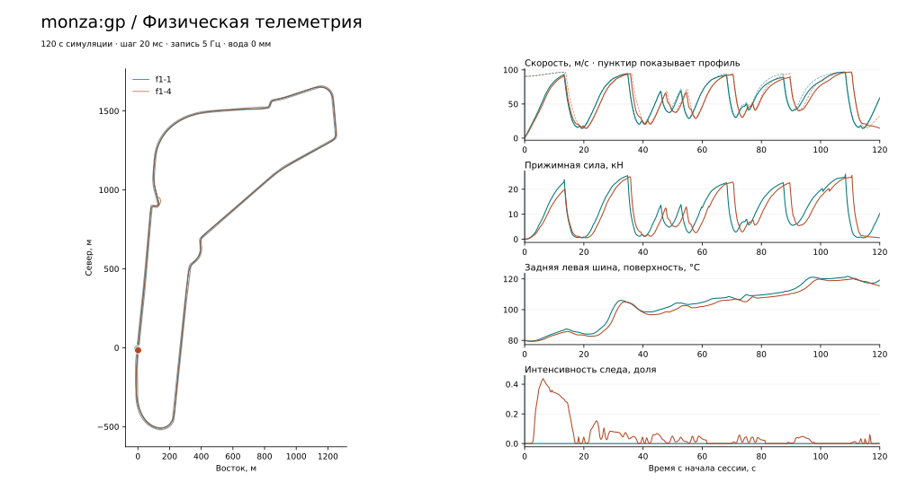

# Динамика автомобиля · ревизия физики 2

[Аудит по квалификационной телеметрии 2025, сравнение всех классов и воспроизводимые измерения](AUDIT.md)

На каждом шаге 20 мс C++ получает геометрию из `Track`, вычисляет силы четырёх колёс, переносит автомобиль и проверяет движение кузовов до следующего шага. Время круга равно интервалу между двумя последовательными пересечениями створа в прямом направлении. Момент пересечения интерполируется по пройденному участку внутри тика. Сектора имеют собственные створы из конфигурации трассы. Участок от заднего ряда решётки до первого створа в длительность первого полного круга не входит.



Точки на плане и вертикальные указатели на графиках воспроизводят 120 секунд нативной записи двух заявок с шагом выборки 0,2 с. В статическом просмотрщике остаются полные кривые. Откройте SVG в браузере для воспроизведения. Тонкая линия внутри границ показывает фактический путь машины. Оси плана заданы в локальных метрах.

```sh
uv sync --locked --python 3.12 --extra studio-tools
uv run --locked python scripts/build_race.py --test
uv run --locked --extra studio-tools python scripts/inspect_dynamics.py monza:gp monza.svg --entries f1-1 f1-4 --seconds 120
uv run --locked python scripts/benchmark_dynamics.py --series wec --seconds 900 --sessions 4
uv run --locked python scripts/benchmark_dynamics.py --series kart-ok --cars 36 --seconds 180 --sample-every 0
```

## Сборка и игровые классы

`Session.for_event(state, event_id, entries, options=..., kind=...)` принимает заявки в порядке решётки на дату текущего состояния карьеры. Оркестратор разрешает версию карты, монтаж, действующую конфигурацию программы, допуски и состояние экземпляров. После допуска сессия владеет копией параметров и связей с производителем, контрактом, редакцией и серийным номером. Инженерная диагностика может открыть опубликованную стартовую сборку через `opening_vehicle`. Оба пути вызывают один конструктор нативной сессии.

| Семейство | Что меняется в физике |
|---|---|
| F1 | 8 передач, гибрид, регулируемое заднее крыло, составы C1–C6, промежуточные и дождевые шины |
| F2, F3 | 6 передач, собственные двигатели, диапазоны оборотов, размеры и чертежи шин, DRS |
| F4 Италии, Великобритании и Испании, Formula Regional | Сборки F4 и FR, 6 передач, упрощённый аэропакет в чертежах, слики и дождевые шины |
| DTM GT3, WEC LMGT3 | 6 передач, ABS, более высокий центр тяжести, свои номиналы мощности, тепловой нагрузки и ресурса шин, старт с хода |
| WEC Hypercar | Раздельные LMH с передней электрической осью, LMDh с электрической машиной в задней трансмиссии и атмосферная Valkyrie. Потолок общей мощности сохраняется при разряде батареи |
| OK и OK-Junior | Жёсткая задняя ось, одна постоянная передача, торможение задней осью, старт с хода, собственные масса, радиус, мощность и предел оборотов |

Сухая масса равна сумме масс всех установленных групп. Масса шин в чертеже уже охватывает комплект. К сухой массе прибавляются пилот с балластом и оставшееся топливо. Параметры поставщика из ранних сохранений дополняются штатной функцией совместимости профиля. Мощность на колёсах, аэродинамическая площадь и тормозное усилие из статического стендового расчёта `assembly()` используются инженерным отделом. На трассе каждая из этих величин вычисляется из исходных чертежей при текущих условиях. [Реестр деталей](../../backend/components/design.py) · [Сезонные характеристики](../../backend/opening/engineering.py) · [Размеры и настройки](../../backend/race/vehicles.py)

## Силы и интегрирование

Расчёт ведётся в м, с, кг, Н и рад. Напор воздуха `q = ρv²/2`, где `ρ = 1,225 кг/м³`. Номиналы двигателя и тепловые потоки заданы в кВт, энергия в кДж, давление шин в кПа относительно атмосферы, температура в °C. Упругости чертежей заданы в Н/мм, клиренсы в мм.

- Сопротивление равно `q (CdA_кузова + 0,55 A_впуска u_охл + CdA_крыла u_крыла² f_DRS) (1 − 0,31 W)`. Чертёж шасси формулы включает переднее крыло и его индуцированное сопротивление. Прижимная сила заднего крыла пропорциональна углу настройки в нормированных единицах. Днище зависит от клиренса. Последовательная податливость платформы и комплекта шин даёт сжатие `Δh = F (1/k_подв + 1/k_шин)`. Нагрузка для этого приближения берётся по свободным площадям обоих крыльев и днища. Прогрессивный ограничитель хода использует `H tanh(Δh/H)`, где `H` — доступный ход до упора. Эффективность днища убывает с отклонением от проектного зазора. Неровность снижает эффективность жёсткой платформы.
- Передняя ось получает статическую долю веса, аэродинамическую нагрузку передней части и перенос `−m aₓ h/L`. Оставшаяся нагрузка приходится на заднюю ось. Перенос между колёсами равен `m aᵧ h/B`, где `B` — оценочная колея. Доля переднего стабилизатора распределяет этот перенос между осями. Топливная ячейка смещает центр тяжести вниз и назад. Для устойчивости явного шага перенос использует ускорения предыдущего тика.
- Для угла управляемых колёс `δ` запрошенная кривизна равна `tan(δ)/L`. Поперечная сила зависит от `m v² κ`, поперечного уклона и затухания бокового скольжения после контакта. Для каждого колеса запросы тяги, тормоза и поворота ограничиваются общим кругом `hypot(Fₓ,Fᵧ) ≤ μFz`. Продольная работа уменьшает доступное боковое усилие. Баланс тормозов задаёт доли осей. Настройка дифференциала меняет передачу момента на нагруженную сторону и потери от рассогласования окружных скоростей в повороте.
- `aₓ = (ΣFₓ − D − Fкач)/m − gₙ·grade`, `aᵧ = ΣFᵧ/m − gₙ·crossfall`. Скорость интегрируется явным шагом, перемещение — по средней скорости на шаге. Поворот направления зависит от достигнутого поперечного ускорения. Для движения в локальной системе учитываются угол к касательной, боковая скорость, уклон и множитель `1/(1−κ_оси d)`. На вылете меняются сопротивление качению и доступное сцепление. [Силы и движение](../../native/race/vehicle.cpp)

## Тяга, охлаждение и след

Обороты определяются скоростью колеса и выбранным передаточным отношением. Промежуточные ступени распределены геометрически между первой и высшей передачами чертежа. Сглаженная кривая момента ограничена пиком чертежа, номинальной мощностью, температурой и пределом входного момента трансмиссии. Сила тяги равна `T · i · η / r`. Во время переключения тяга прерывается на время поставщика. Контроллер принимает также запрос номера передачи и проверяет обороты при понижении.

Расход топлива в кг за шаг равен `P_ДВС[кВт] · BSFC[г/кВт·ч] · Δt / 3 600 000`. В расход идёт переданная мощность ДВС. Прибавление электрической мощности соблюдает общий номинал силовой установки. У F1 оценочная электрическая доля составляет до 120 кВт, запас 4 МДж, выдача до 4 МДж и рекуперация до 2 МДж на круг. Рекуперация использует фактическое тормозное усилие электрической оси, скорость, КПД 0,72, оставшуюся ёмкость и кинетическую энергию. Для передней электрической оси LMH принят оценочный порог выдачи 190 км/ч. Для LMDh принят задний мотор на 50 кВт. Датированные таблицы BoP и управление MGU-H по режимам требуют дополнительных исходных данных.

Тепловое состояние меняется по балансу `C dT/dt = Q_двигателя + Q_трансмиссии − Q_радиатора`. Теплоёмкость связана с расходом теплоносителя. Отвод зависит от площади впуска, раскрытия охлаждения, скорости, термостата и температуры среды. Перегрев снижает доступную мощность.

След вычисляется по состоянию всего поля на **начало** шага. Продольная дистанция периодична через финиш. Интенсивность `W` затухает экспоненциально по зазору между кузовами и по квадрату бокового смещения. Ширина струи растёт с удалением от лидера. В расчёт входят скорости обеих машин, ширина, сопротивление и крыло лидера и площадь днища ведомого. Используется самый сильный из пересекающихся следов. Переднее крыло теряет до `0,35 W`, заднее — до `0,21 W` своей нагрузки, днище до `0,42 W`, охлаждающий поток до `0,33 W`. Разные плечи приложения нагрузки меняют аэробаланс. На прямой выигрывает сопротивление, в повороте уменьшается запас сцепления.

DRS проверяет класс, разрешение сессии, зону активации, воду и торможение. В гонке и спринте требуются завершённый круг и интервал до предыдущей машины не более секунды в створе детекции. Интервал берётся по времени пересечения, включая случай двух машин внутри одного тика. У карт #16 есть зоны активации. Положение детектора принято за 150 м до начала каждой зоны и обозначено как игровая оценка.

## Шины и настройка

У установленного комплекта есть серийный номер, у четырёх колёс — производные устойчивые ID. Начальный износ читается из состояния экземпляра. `Session.tyre_sets()` переносит температуры, повреждения и циклы в следующую сессию через аргумент `tyre_sets`. Проверяются редакция, состав и идентичность колёс. Внутри сессии доступны раздельные холодные давления.

- Горячее давление рассчитывается по абсолютной температуре каркаса. При неизменном объёме `pгор = (pхол + 101,325) (Tкарк + 273,15)/293,15 − 101,325`. Коэффициент сцепления использует окно состава, давление, чувствительность к вертикальной нагрузке, поверхность, глубину воды, остаток резины и повреждения.
- Поверхность и каркас имеют раздельные теплоёмкости, полученные из энергии прогрева комплекта и температурного окна. Поверхность получает тепло деформации и скольжения, обменивается теплом с каркасом, асфальтом и воздухом и излучает `εσA(T⁴−Tвозд⁴)` в абсолютных температурах. Тормозная блокировка добавляет локальную работу скольжения. Вода усиливает теплоотдачу.
- Базовая потеря резины в мм равна `дистанция_м × wear_mm_100km / 100000`. Поправки учитывают состав, шероховатость, тепловое состояние, работу колеса и плоское пятно. Гранулирование растёт при холодном нагруженном скольжении и может уходить в окне. Блистеринг и термическая деградация накапливаются от горячей работы. Прогрев каркаса после остывания ниже окна на 18 °C регистрирует следующий цикл. Предельные износ, пятно или блистер дают прокол конкретного колеса.
- При воде шина вытесняет объём `глубина_мм × ширина_м × скорость_м/с` в литрах в секунду. Сравнение с водоотводом чертежа и состава уменьшает доступное сцепление. В этой версии глубина воды и температуры среды постоянны в пределах сессии. Пространственная погода относится к #20.

Диапазоны регулировок заданы по физическому классу. Можно менять крыло, высоту платформы, упругость, распределение стабилизаторов, блокировку дифференциала, тормозной баланс, впуск и давление колёс в пределах допуска. На картах остаются давление и охлаждение. Управляющие команды изменяют угол руля, газ, тормоз, передачу, расход батареи и предпочтительное смещение. В расчёте времени отсутствует коэффициент навыка или качества настройки.

## Линия, решётка и контакты

Планировщик начинает с `Lines`, сглаживает мировую линию в границах полосы и оценивает вариант с выравниванием геометрической кривизны хорд. Обратные проходы распространяют предел торможения перед поворотом, прямые — доступную тягу с учётом поперечной нагрузки. Критерий выбора равен `Σ 2Δl/(vᵢ+vᵢ₊₁)`. Контроллер использует профиль ускорения, кривизну, ошибку направления и поперечного положения. При вводе предпочтения и возвращении на линию применяется упреждающая точка. Геометрия кандидатов разделяется внутри сессии. Полный профиль обновляется при изменении диапазона массы (10 кг) или сцепления (0,1). [Планировщик](../../native/race/profile.cpp)

При размещении решётки проверяется ориентированный прямоугольник целиком. На локальной ветви проверяются обе границы каждого затронутого интервала пространственной сетки и учтён поворот нормали между узлами. На шпильке локальный участок заканчивается у первого поперечного сечения за всем кузовом. Затем проверяются пересечения кузовов с учётом высоты. Для оценочной поперечной разметки допускается сдвиг в пределах ряда. Недопустимая явно переданная поза отклоняется.

На шаге центр кузова движется по хорде, угол непрерывно интерполируется. Широкая фаза отбрасывает удалённые пары. Для оставшихся пар разделяющие оси обоих прямоугольников и вертикальный интервал задают нижнюю границу времени до касания. Оценка использует относительную скорость по оси и максимальную дуговую скорость углов. Это покрывает встречные, поперечные и вращательные движения, включая чистые конечные положения. Сначала обрабатывается самое раннее касание. Импульс по нормали определяется относительной скоростью и обратными массами, коэффициент восстановления равен 0,08. Оставшийся интервал повторно проверяется с изменёнными скоростями. При зажатии нескольких кузовов исчерпавшая итерации контактная группа удерживается до конца текущих 20 мс. Боковой импульс гасится шинами в последующих шагах. [Непрерывная проверка](../../native/race/contact.cpp) · [Порядок шага](../../native/race/dynamics.cpp)

## Пакеты, воспроизведение и ограничения

`advance(ticks, sample_every=N)` выполняет шаги под освобождённым GIL. Период отсчитывается по абсолютному номеру тика. Нулевой период отключает выборку. Один пакет ограничен 262 144 шагами автомобилей и 32 768 строками телеметрии. Вне горячего цикла `channel_blocks` формирует `ChannelBlock` #35, а `event_facts` — измеренные круги с секторами и факты контактов. Круг получает допуск к рекорду на этапе спортивной проверки. Установка, версия, экземпляр и договор взяты на дату допуска. Энергетические каналы, DRS и коробка публикуются в соответствии с оснащением. Чтение использует существующие права статистики. Техническая утилита работает на опубликованных стартовых чертежах. [Пакетный контракт](../../backend/race/session.py) · [Архив и права](../../backend/statistics/telemetry.py)

JSON-checkpoint формата 1 с отметкой ревизии физики включает зафиксированную конфигурацию с seed, координаты и скорости, состояние колёс, температуры и ресурсы, текущую передачу и незавершённое переключение, времена детекторов и секторов, активные контакты, команды и очередь. Физические формулы детерминированы и не расходуют случайные числа. Повтор одного тика для одной заявки в очереди отклоняется до её изменения. В пределах сборки проверяется точное совпадение пакетов и состояния после JSON save/load. Для межплатформенного теста секундного манёвра заданы абсолютные допуски 0,0001 м, 0,0001 м/с и 0,0001 °C.

Это модель 2.5D с квазистационарным переносом нагрузки. Размеры, CG, промежуточные передаточные числа, формы кривых момента, аэродинамический след и коэффициенты теплообмена — игровые инженерные оценки. Шины используют эквивалентные потери скольжения и единый предел сил, подвеска — эффективные упругости. Деформация кузова, контакт с барьерами, ремонт и обслуживание относятся к #19. Программы пилотов, тактика обгона и обход остановившейся группы относятся к #18. Карт с прямым приводом после полной остановки требует внешнего запуска. При чрезмерно плотной решётке поле может остановиться. Сценарии полной гонки с пит-стопами и калибровка диапазонов сезона относятся к последующим этапам эпика.

[Задача #17](https://github.com/Troyevv/autosport_sim/issues/17) · [Геометрия и происхождение исходных данных](../issue-16/README.md)


## Проверочные прогоны

Release, Linux x86-64, GCC 14.2, CPython 3.12. Время по стеновым часам включает создание независимых сессий, преобразование выборок в Python, JSON-checkpoint и проверку продолжения. Машинный шаг — один автомобиль за 20 мс игрового времени.

| Сценарий | Фактический результат |
|---|---|
| 4 параллельных сессии WEC, по 36 заявок на Сарт, по 900 с, выборка 5 Гц | 6,48 млн машинных шагов. Медиана трёх прогонов 5,246 → 3,834 с. По 162 000 строк на сессию, 108 кругов суммарно на поле, все 36 машин в движении. Итоговые состояния параллельных сессий совпали |
| 36 картов OK, Рёдби, 180 с, запись отключена | 324 000 шагов. Медиана трёх прогонов 0,476 → 0,375 с. 72 круга суммарно, все 36 машин в движении. Продолжение из checkpoint совпало |
| Ferrari №44, 35 кг топлива, начальная температура шин 95 °C, второй полный круг | Монца 110,755 → 96,535 с, Монако 104,463 → 90,896 с. Условия квалификации и реальные ориентиры приведены в [аудите](AUDIT.md) |

Функциональные проверки охватывают десять классов, баланс работы и расхода топлива, круг сцепления, температуру и воду, блокировку и прокол, состав на коротком круге и на 20 кругах, энергию и условия DRS. Регрессионные проверки включают углы кузова и узкую выемку между углами, разворот и поперечное пересечение за один тик, мост, перестановку заявок с сохранёнными стартовыми позами, запись архива дважды и перенос очереди команд. Короткий нативный заезд выполняется также с ASan и UBSan.
