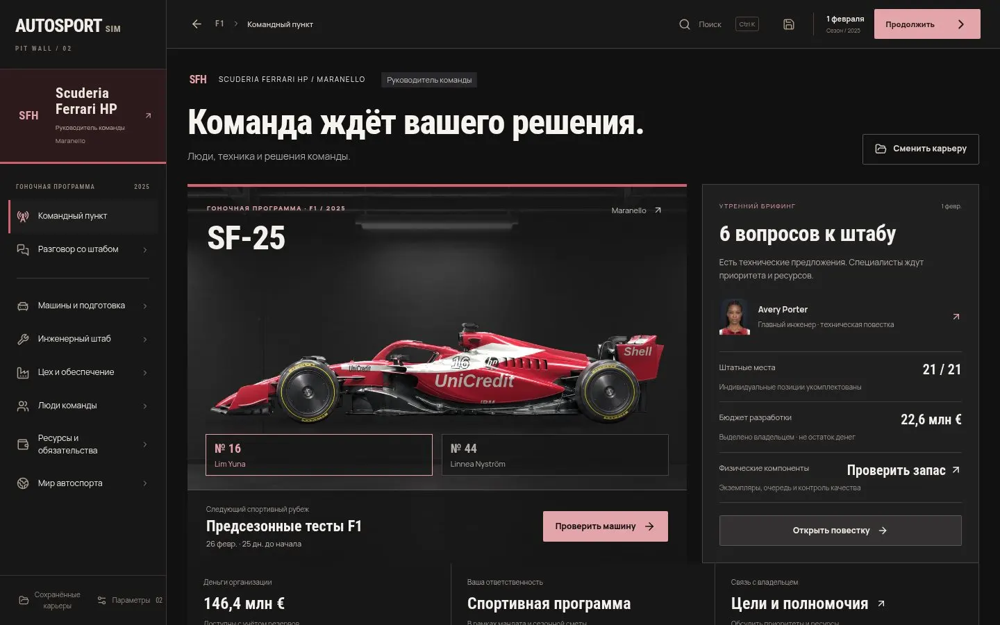
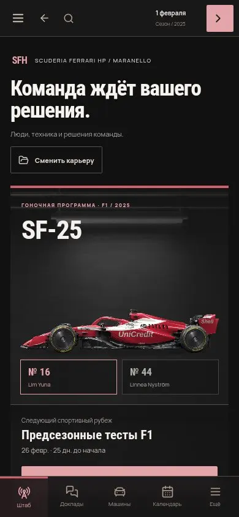
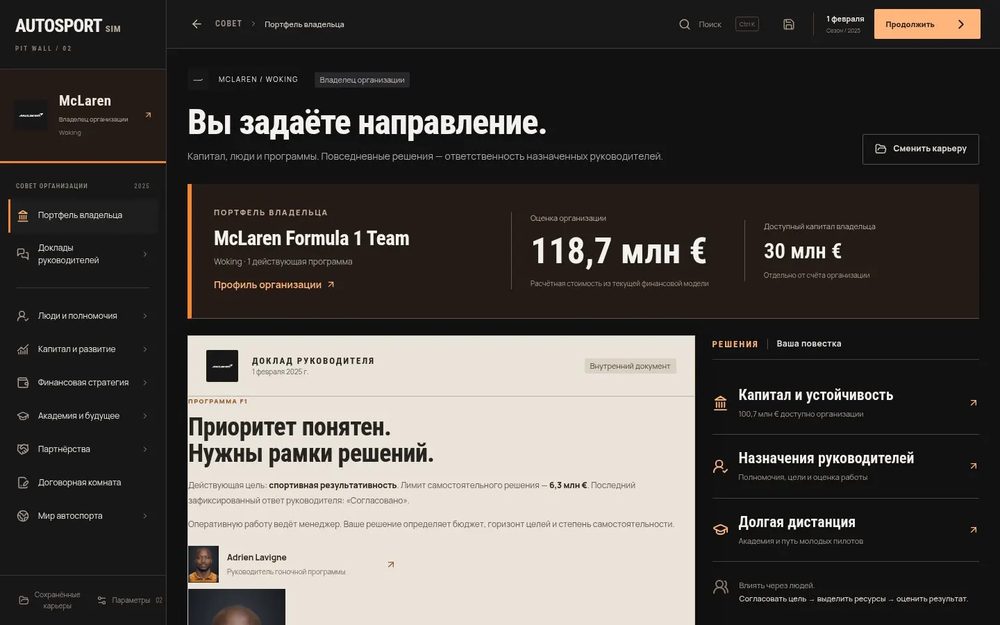
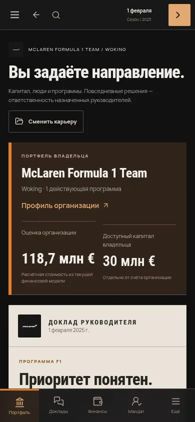
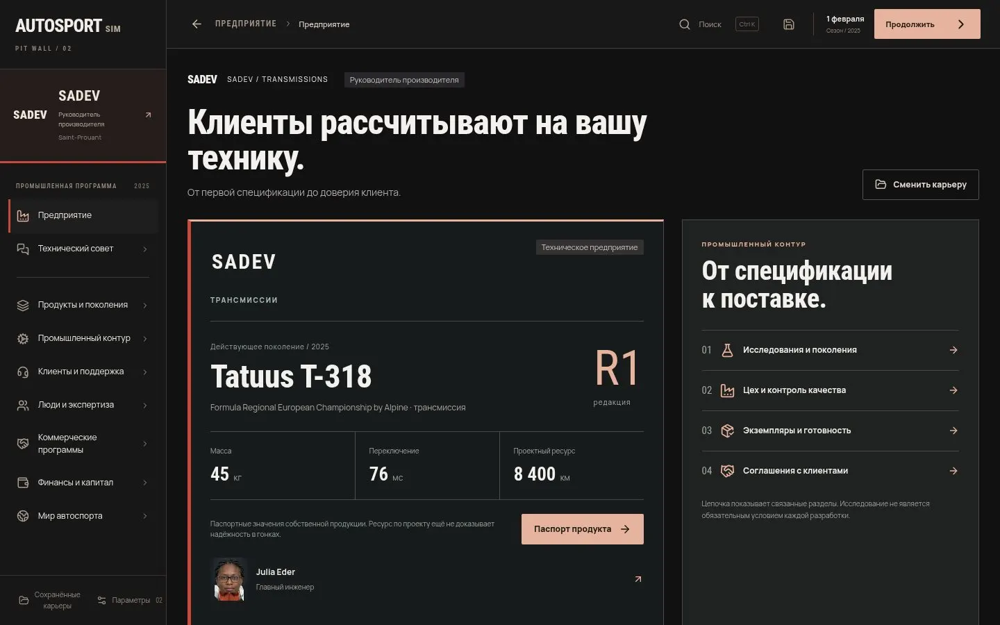
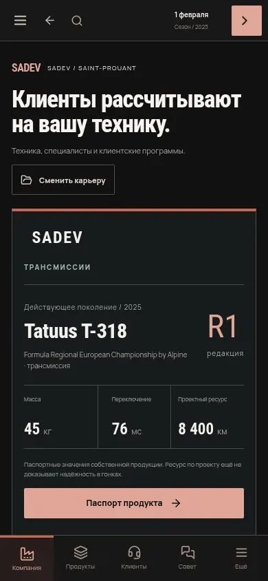

# PIT WALL 02 в действующей карьере

Рабочие места менеджера Ferrari F1, владельца McLaren F1 и производителя трансмиссий SADEV в FRECA сняты в реально запущенной игре. Каждая карьера создана через четыре шага мастера, с подтверждённым ответом API 201. Стартовая дата 1 февраля 2025 года, seed 42. Три сохранения независимы. Изображения ниже открывают полные кадры.

| Роль | Desktop | Mobile |
| --- | --- | --- |
| Менеджер | [](screens/manager-overview-1440.webp) | [](screens/manager-overview-390.webp) |
| Владелец | [](screens/owner-overview-1440.webp) | [](screens/owner-overview-390.webp) |
| Производитель | [](screens/manufacturer-overview-1440.webp) | [](screens/manufacturer-overview-390.webp) |

[Галерея экранов и состояний](gallery.md) · [Парные снимки эталона и игры](comparison.md) · [Разбор всех 45 замечаний аудита](audit.md) · [Контракты для #16–24](race-contracts.md).

## Проверка интерфейса

В Chromium проверено 102 сочетания роли, раздела и начальной вкладки. Для каждого сняты окна 1440 × 900, 390 × 844 и 844 × 390. Для трёх главных страниц добавлен 1920 × 1080. Получилось 309 первичных кадров. В этих точках проверялись заголовок страницы, завершение загрузки, ошибки JavaScript и API, горизонтальное переполнение окна и рабочей области. Главное меню, библиотека и шаги создания сняты отдельно.

На тех же сохранениях проверены раскрытие и переключение аналитики, поиск на рынке, открытие досье, возврат к списку, смена статистической категории, выбор документа в переговорной, выбор серии, открытие дня календаря и всех слотов машины. Для инженерных, финансовых, кадровых и производственных команд используются отдельные тестовые карьеры. Это позволяет проверить как начало игры, так и последствия решения.

| Сценарий | Что проверено |
| --- | --- |
| Менеджер | Создание и восстановление карьеры, обязательный брифинг, работа с двумя машинами и гаражом, компоненты и установка по наряду, повестка совета, исследование, разработка, выпуск или отказ, производство, контроль качества, склад и назначение экземпляра. |
| Владелец | Мандат менеджера, академический договор, финансовые счета и роль собственника, контрольный пакет, инвестиции, капитал и база. Агрегированные доклады используют права той же карьеры. |
| Производитель | Редакции продукции, клиентские заявки, консультанты, работа с технической поддержкой и правами на данные. Производитель SADEV и шинный производитель в WEC проверены на разных программах. |
| Кадры и договоры | Переход к человеку из реестра, условия, встречное предложение, будущая дата вступления, назначение резерва, иерархия и замена пилота. После значимого решения проверяется возврат из сообщения к работе. |
| Данные и сохранение | Сверка сводного запроса с существующими API, импорт и экспорт, идемпотентное повторение команд, миграция, отсутствие повторной установки или списания ресурсов, журналы профессиональных и финансовых фактов. |

## Воспроизведение проверок

Запустить приложение по [инструкции проекта](../../README.md). Для повторения сценариев в тестовом контуре:

```sh
uv sync --locked --extra studio-tools
uv run --locked pytest -q
uv run --locked python tests/finance_endurance.py --years 3
cd frontend
npm ci
npm run lint
npm run build
npm run smoke
```

Playwright запускает изолированную карьерную базу и production preview. Для системного Chromium можно задать переменную `CHROMIUM_PATH`. Проверки используют фактический seed и начальное наполнение, финансовые операции и кадровые решения проверяются отдельными сценариями.

## Баланс

В изолированном финансовом прогоне за три года с seed 42 число проводок на 1 февраля 2026, 2027 и 2028 составило 16 446, 32 514 и 49 104. Сумма денег системы на всех трёх датах — 215 428 312 120 центов. К третьей дате одна организация прошла банкротство. Результаты гонок для этого прогона не создавались.

Отдельный инженерный тест проходит три сезона в одном состоянии. На каждом шаге проверяется доступная квота CFD. Для сезонов без опубликованной классификации сначала проверяется отказ, затем доверенный тестовый источник задаёт классификацию. Повтор авторизации не расходует ресурс второй раз, конкурирующий заказ сверх квоты отклоняется, установленная машина не изменяется. Дополнительные регрессии проверяют отрицательные результаты разработки, физическую конкуренцию за экземпляр, ограниченную применимость знаний, два поколения машины, миграцию и переносимый архив.

## Границы воспроизведения

- В игре доступны факты и права её backend. Расчёт спортивных результатов, отдельные демонстрационные статистические ряды, публикации СМИ и ручное создание календарного события в карьерном API отсутствуют. В этих местах показаны пустые состояния или объяснение недоступности. Демонстрационная гонка открывается отдельно от карьеры.
- Наименования организаций, суммы, даты действия и занятость специалистов могут отличаться от данных демонстрационного сценария. Они читаются из выбранного сохранения.
- В регистрах и мастерских использованы действующие серверные команды. Нативные редакторы ливреи, отдельных предложений, клиентского обслуживания и некоторых производственных операций отличаются от эталона порядком полей и компоновкой. Эти расхождения учитываются при визуальной приёмке.
- Мобильные размеры проверены в Chromium, в том числе с touch-профилем в Playwright. Safari/iOS на физическом устройстве и поведение системной экранной клавиатуры отдельно не проверялись.
