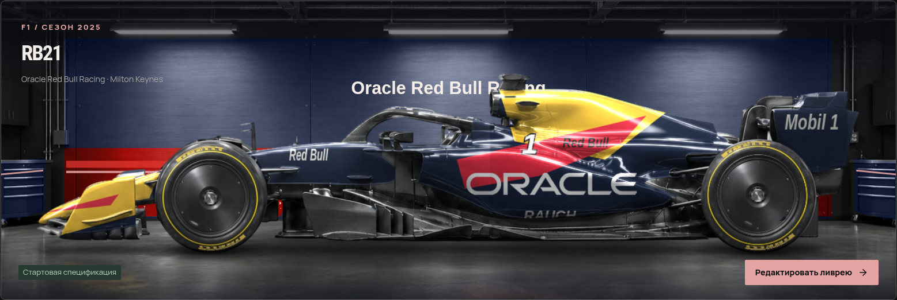
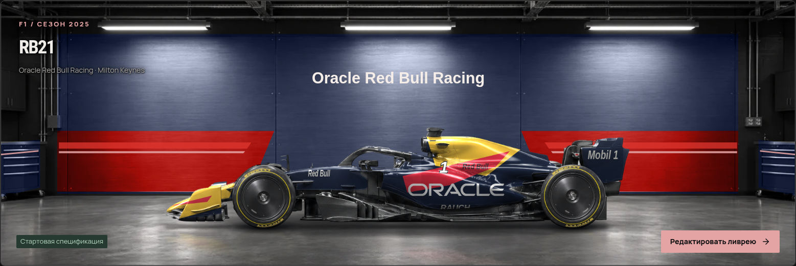
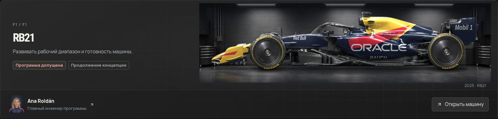
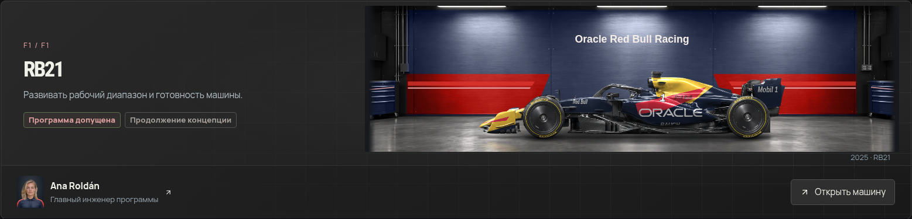
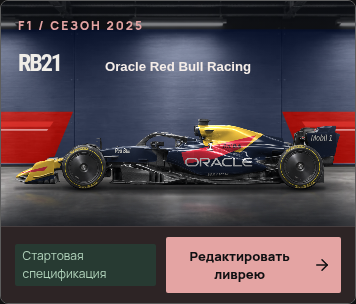
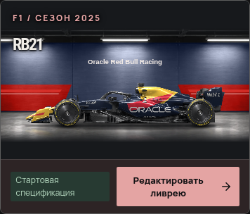

# Положение автомобиля в боксе

Одна карьера руководителя Oracle Red Bull Racing, одно шасси RB21 №1 и заводская ливрея. Слева сборка `6eaf536`, справа исправленная сцена. Снимки сделаны в Chromium при масштабе 100%. Каждая ссылка открывает область игры в исходном разрешении.

| Экран и размер окна | До | После |
| --- | --- | --- |
| Гараж, 1920 × 1080 |  |  |
| Техническая программа, 1920 × 1080 |  |  |
| Гараж, 390 × 844 |  |  |

Прежде машина занимала до 93% ширины собственного контейнера, фон кадрировался независимо, а страницы сдвигали колёса нижним отступом. На первом снимке воздухозаборник RB21 перекрывает название команды. В технической программе задняя стена была без оформления.

Теперь фотография бокса, стена, освещение и машина используют координаты одного снимка 1600 × 533. Стык стены с полом находится примерно на высоте 394 пикселей от верхнего края. Ближние колёса припаркованы на линии 458 пикселей. По двум точкам контакта из атласа построены тень и отражение. Ширина видимого бокса на этой глубине принята за 9,6 м. RB21 длиной 5,6 м занимает 58,3% ширины фотографии в обоих разделах. Узкие и панорамные окна кадрируют всю сцену целиком.

Графическая эмблема берётся из каталога организации. Для Oracle Red Bull Racing в каталоге отсутствует эмблема с подтверждёнными условиями распространения, поэтому на снимках видно полное название команды. [Мобильный просмотр ливреи McLaren с графической эмблемой](modal-390.webp) · [Каталог эмблем](../wardrobe/logos.md).

Браузерная проверка охватывает все 33 кузова каталога. Она измеряет положение непрозрачных пикселей шин и тени под ними, глубину стоянки относительно пола, свободное пространство по краям и просвет до вывески. При визуальной сверке отдельно просмотрены RB21, Ferrari 296 GT3, Toyota GR010 и McLaren MCL39.

В карточке чемпионата показатели теперь занимают собственную колонку. Переднее крыло и колесо видны целиком при открытой таблице заявок. [Formula 1, окно 1366 × 768](championship-1366.webp).
